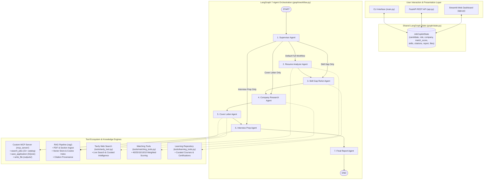

# 💼 Job Application Copilot AI Agent (Task 10)

[](https://www.python.org/downloads/)
[](https://github.com/langchain-ai/langgraph)
[-green.svg)](https://modelcontextprotocol.io)
[](https://streamlit.io)
[](https://fastapi.tiangolo.com)
[](test_system.py)

A production-grade, web-based multi-agent **Job Application Copilot** designed for final-year university students and job seekers. The system assists candidates through an end-to-end job application lifecycle with **strict anti-hallucination guardrails**, explainable match scoring, RAG citation provenance, ReAct upskilling roadmaps, Tavily web research, and Model Context Protocol (MCP) tool integration.

---

## 1. Project Overview

The **Job Application Copilot** automates and elevates every step of preparing job applications:
1. **Resume Ingestion**: Ingests candidate resumes in PDF or plain text formats, chunked with section awareness.
2. **Job Discovery & Matching**: Queries a realistic 21-job catalog via custom MCP tools or accepts custom job descriptions.
3. **Explainable Match Scoring**: Evaluates fit across 5 weighted dimensions (Technical: 40%, Experience: 25%, Education: 15%, Projects: 10%, Certifications: 10%).
4. **Non-Fabrication Skill Audit**: Audits candidate strengths and identifies missing skills labeled explicitly as `Not found in resume`.
5. **ReAct Upskilling Agent**: Executes a tool-calling ReAct reasoning loop (bounded by `MAX_ITERATIONS = 5`) to generate practical learning plans.
6. **Company Intelligence via Tavily**: Researches target company culture, products, news, and tech stack, returning source URLs.
7. **Tailored Cover Letter**: Drafts a 300–450 word grounded letter saved to `outputs/` via MCP `write_file`.
8. **Interview Preparation Coaching**: Generates 10+ Technical, 5+ Resume-based, 5+ Behavioral (STAR method), and 5+ Company-specific questions with answer blueprints.
9. **Application Tracking**: Persists application records in SQLite (`data/applications.db`).
10. **Dual-Mode Execution**: Live external API mode (Gemini/OpenAI/Tavily) + 100% self-contained offline Demo Mode.

---

## 2. System Architecture



---

## 3. Agent Responsibilities

| Agent | Module | Primary Responsibility |
| :--- | :--- | :--- |
| **Supervisor** | `agents/supervisor.py` | Extracts candidate name, target role, and company. Conditionally routes workflow based on user intent. |
| **Resume Analyzer** | `agents/resume_analyzer.py` | Compares resume against JD using RAG. Produces 5-dimension explainable match score (40/25/15/10/10). |
| **Skill Gap Agent** | `agents/skill_gap.py` | ReAct reasoning loop (bounded by `MAX_ITERATIONS = 5`). Classifies gaps (HIGH/MED/LOW) and retrieves courses. |
| **Company Research** | `agents/company_research.py` | Queries Tavily for company overview, culture, recent news, technologies, and source URLs. |
| **Cover Letter** | `agents/cover_letter.py` | Drafts a 300–450 word tailored cover letter with strictly zero hallucination; saves to `outputs/` via MCP. |
| **Interview Prep** | `agents/interview_prep.py` | Creates 25+ categorized questions (10 Tech, 5 Resume, 5 STAR Behavioral, 5 Company) with answer tips. |
| **Final Report** | `agents/final_report.py` | Synthesizes all outputs into the 8-section master report defined in Task 10 Section 11. |

---

## 4. MCP Server Architecture

The Model Context Protocol (MCP) server is located in `mcp_server/` and provides three standardized tools:

1. **`search_jobs(role, location, keywords)`**:
   - Queries `data/jobs.json` containing 21 realistic mock listings across *Data Analyst, Machine Learning Engineer, Software Developer, Python Developer, AI Engineer, Cloud Engineer, etc.*
   - Returns structured listings with required skills, preferred skills, experience, and salary benchmarks.
2. **`save_application(company, role, application_date, status, notes)`**:
   - Persists application tracking entries into SQLite (`data/applications.db`).
   - Supports statuses: `Interested`, `Applied`, `Interview`, `Offer`, `Rejected`.
3. **`write_file(filename, content)`**:
   - Safely sanitizes filenames against path traversal attacks.
   - Saves documents to `outputs/` directory (e.g., `outputs/<candidate_name>_<company>_cover_letter.txt`).

---

## 5. RAG Pipeline with Citations

The RAG engine (`rag/`) enforces strict attribution:
- **`rag/ingest.py`**: Extracts text from PDFs (via `pypdf` with raw PDF stream fallbacks) and plain text documents. Chunks text by recognizable headers (`EDUCATION`, `TECHNICAL SKILLS`, `PROJECTS`, `EXPERIENCE`, etc.).
- **`rag/vectorstore.py`**: Stores chunks and computes semantic cosine similarity using token embeddings with section header boosting.
- **`rag/retriever.py`**: Formats retrieved evidence with explicit provenance tags:
  ```text
  --- Citation: [Resume: Section 'Technical Skills'] ---
  Python, SQL (PostgreSQL, MySQL), Tableau, Pandas, Scikit-Learn

  --- Citation: [Job Description: Section 'Preferred Qualifications'] ---
  Familiarity with cloud data warehouses (Snowflake, BigQuery).
  ```

---

## 6. Strict Guardrails

1. **Zero Fabrication**: The agent NEVER hallucinates work experience, employers, degrees, projects, or metrics not present in the resume. Unproven skills are explicitly labeled as `Not found in resume`.
2. **Provenance Separation**: Findings are cleanly partitioned into **RESUME EVIDENCE**, **JOB DESCRIPTION EVIDENCE**, and **WEB RESEARCH INFORMATION**.
3. **Privacy**: Candidate resume data is processed within the session and never logged to external monitoring tools.
4. **Fairness**: Hiring assessments are free from bias regarding race, gender, religion, age, disability, caste, or nationality.

---

## 7. Step-by-Step Instructions: How to Run in VS Code

Follow these straightforward steps to open, configure, and run the project inside Visual Studio Code:

### Step 1: Open the Project in VS Code
1. Launch **Visual Studio Code**.
2. Click **File > Open Folder...** (or press `Cmd+O` on macOS / `Ctrl+O` on Windows).
3. Select the `job_application_copilot` folder:
   ```bash
   /Users/santhoshsivanbn/.gemini/antigravity/scratch/job_application_copilot
   ```

### Step 2: Open an Integrated Terminal in VS Code
- Press `` Ctrl+` `` (or go to **Terminal > New Terminal** in the top menu).

### Step 3: Create & Activate a Python Virtual Environment
In the VS Code terminal, run:

```bash
# macOS / Linux:
python3 -m venv venv
source venv/bin/activate

# Windows (Command Prompt / PowerShell):
# python -m venv venv
# .\venv\Scripts\activate
```

### Step 4: Install Dependencies
```bash
pip install -r requirements.txt
```

### Step 5: Configure Environment Variables (Optional)
The project is preconfigured with a complete **Demo Mode** and curated intelligence so it works immediately without API keys!

If you wish to use live LLMs or live Tavily search:
1. Duplicate `.env.example` to `.env`:
   ```bash
   cp .env.example .env
   ```
2. Open `.env` in VS Code and insert your API keys:
   ```ini
   OPENAI_API_KEY=sk-...
   # Or for Google Gemini:
   GOOGLE_API_KEY=AIza...
   # For live web search:
   TAVILY_API_KEY=tvly-...
   ```

### Step 6: Run the Comprehensive Automated Test Suite
Run the 16-test capstone verification suite:
```bash
python3 test_system.py
```
*(Or with pytest: `pytest -v tests/`)*

Expected output:
```text
======================================================================
 🌟 ALL 16 TESTS PASSED PERFECTLY! (100% COMPLIANT) 🌟 
======================================================================
```

### Step 7: Launch the Application

#### Option A: Streamlit Interactive Web Dashboard (Recommended)
```bash
streamlit run app.py
```
- VS Code will prompt you or open your browser at `http://localhost:8501`.
- Explore all 7 tabs: Overview, Resume Match, Skill Gaps, Company Research, Cover Letter, Interview Prep, and Application Tracker.

#### Option B: FastAPI Backend API Server
```bash
uvicorn api:app --reload --port 8000
```
- Interactive Swagger documentation will be available at: `http://localhost:8000/docs`.

#### Option C: Command Line Interface (CLI)
```bash
python3 main.py
```
- Run end-to-end multi-agent orchestration directly in your terminal.

---

## 8. Example Queries & User Prompts

You can test custom queries in the Streamlit UI or CLI:
- *"Perform full evaluation, identify skill gaps, write cover letter, and generate interview prep for Zoho Junior Data Analyst"*
- *"How well does my resume match this JD?"*
- *"Generate tailored cover letter only"*
- *"Prepare technical and behavioral interview questions only"*

---

## 9. Verification & Test Matrix

The test suite in `tests/` verifies all Task 10 capstone requirements:
- `tests/test_resume_analyzer.py`: Factual skill extraction, 5-dimension weighted scoring (40/25/15/10/10).
- `tests/test_mcp_tools.py`: 21-job catalog schema, SQLite application persistence, safe file writing.
- `tests/test_guardrails.py`: **Proves the system does NOT invent candidate skills, degrees, or employers.**
- `tests/test_workflow.py`: End-to-end 7-agent LangGraph workflow execution.
- `tests/test_tavily.py`: Tavily web search and graceful offline fallback handling.
- `tests/test_cover_letter.py`: Cover letter generation (300-450 words) and MCP file saving.
- `tests/test_skill_gap.py`: ReAct loop termination bounded by `MAX_ITERATIONS = 5` and priority classification.

---

## 10. Project Structure

```text
job_application_copilot/
│
├── app.py                     # Streamlit 7-tab Web Dashboard
├── api.py                     # FastAPI REST API Backend
├── main.py                    # Command-line interface (CLI)
├── requirements.txt           # Project dependencies
├── .env.example               # Environment variables template
├── README.md                  # Comprehensive documentation & guide
├── test_system.py             # Master test suite runner
│
├── agents/                    # Multi-Agent Implementations
│   ├── supervisor.py          # Supervisor & conditional routing
│   ├── resume_analyzer.py     # 5-dimension match scoring & RAG citations
│   ├── skill_gap.py           # ReAct agent (MAX_ITERATIONS = 5)
│   ├── company_research.py    # Tavily web search agent
│   ├── cover_letter.py        # Tailored letter writer & MCP persistence
│   ├── interview_prep.py      # STAR interview coach (25+ questions)
│   ├── final_report.py        # Master 8-section report synthesizer
│   └── llm_factory.py         # Configurable Gemini/OpenAI/MockLLM factory
│
├── graph/                     # LangGraph Orchestration Layer
│   ├── state.py               # Strongly typed JobCopilotState schema
│   └── workflow.py            # Compiled 7-agent StateGraph
│
├── rag/                       # RAG Pipeline & Retrieval Engine
│   ├── ingest.py              # PDF/text parser & section-aware chunker
│   ├── vectorstore.py         # Semantic embedding vector index & cosine similarity
│   ├── retriever.py           # Citation provenance formatter
│   └── pipeline.py            # Session RAG pipeline facade
│
├── tools/                     # LangChain & MCP Tool Wrappers
│   ├── resume_tools.py        # Factual skill extraction
│   ├── matching_tools.py      # 40/25/15/10/10 weighted score calculator
│   ├── learning_tools.py      # Curated upskilling repository
│   ├── tavily_tool.py         # Tavily search & verified intelligence fallback
│   └── mcp_client_tools.py    # MCP tool adapters for LangGraph
│
├── mcp_server/                # Custom Model Context Protocol (MCP) Server
│   ├── server.py              # FastMCP stdio server
│   └── tools/
│       ├── search_jobs.py     # 21+ mock job catalog search tool
│       ├── save_application.py# SQLite application tracker persistence
│       └── write_file.py      # Safe file persistence in outputs/
│
├── data/                      # Data Assets & Local Persistence
│   ├── jobs.json              # 21 realistic mock job listings
│   ├── applications.db        # SQLite database for application tracking
│   ├── sample_resume.txt      # Sample resume for Santhosh Sivan
│   ├── sample_resume.pdf      # Binary PDF of sample resume
│   └── sample_jd.txt          # Sample JD for Junior Data Analyst at Zoho
│
├── outputs/                   # Safe storage for generated files
│   ├── Santhosh_Sivan_Zoho_Corporation_cover_letter.txt
│   └── Santhosh_Sivan_Zoho_Corporation_interview_prep.txt
│
└── tests/                     # Automated Test Matrix (16 Tests)
    ├── test_resume_analyzer.py
    ├── test_mcp_tools.py
    ├── test_guardrails.py
    ├── test_workflow.py
    ├── test_tavily.py
    ├── test_cover_letter.py
    └── test_skill_gap.py
```

---

## 11. Project Limitations & Future Improvements

- **Current Limitations**:
  - Mock job catalog contains 21 curated Indian and global tech roles; real-world live job boards (LinkedIn, Indeed) require commercial scrapers or partner APIs.
  - PDF parser is optimized for standard single/two-column text resumes; highly graphical canvas designs may require OCR.
- **Future Enhancements**:
  - Add Chrome browser automation (via Playwright or MCP browser) to pre-fill web application forms automatically.
  - Multi-candidate comparative ranking for technical recruiters.
  - Real-time voice interview simulation using WebRTC.
